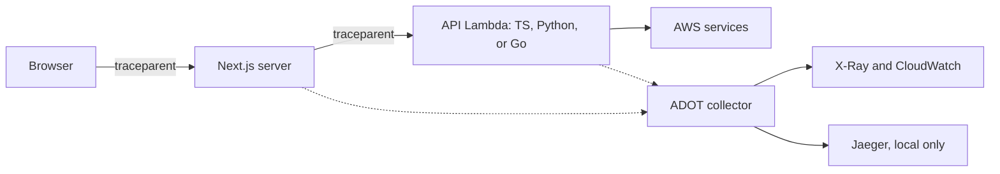

# Observability

This document sets the rules for logs and traces. One request makes one trace. The trace starts in the browser and ends at the AWS call. Each log line of the request carries the trace id.

Status: this document describes the target design (ADR 0009). An item marked "(planned)" is not yet active. Do not treat it as a working gate.

## 1. Architecture



- The browser adds a `traceparent` header to each API call that a client component makes (W3C Trace Context). Most pages call the API from a Server Component. For those pages the trace starts at the Next.js server.
- Browser spans are not exported. The browser only creates the trace id and sends `traceparent`. The trace view shows no browser span. A public OTLP endpoint for the browser is an open decision (a human owns it).
- The Next.js server registers telemetry in `instrumentation.ts`. It continues the browser trace and passes the header on to the API.
- API Gateway (HTTP API) forwards `traceparent` in `event.headers`. The API handler wrapper extracts it (section 2). The API echoes `traceparent` in the response.
- The API sets `requestId` in the error envelope to the trace id.
- AWS SDK calls from the API are child spans.
- Lambda sends spans to the ADOT collector layer. The collector exports to X-Ray and CloudWatch.

## 2. The shared package

`@vprprudhvi/shared-telemetry` (`packages/telemetry`, planned) is the only package that imports the OpenTelemetry SDK (`@opentelemetry/sdk-*`, exporters, instrumentations). App code gets the API types from the re-exports of this package.

| Export | Use |
|---|---|
| `initTelemetry({ serviceName })` | Start the SDK once, at process start. Sets W3C `tracecontext` and `baggage` propagators, the OTLP exporter, and the resource attributes `service.name`, `service.version`, `deployment.environment`, and `cloud.*`. |
| `withSpan(name, fn, attributes?)` | Run `fn` in a new span. It records an exception and sets the error status when `fn` throws. It ends the span. |
| `getTraceContext()` | Return `{ traceId, spanId, traceFlags }` of the active span. |
| `wrapLambdaHandler(handler)` | Wrap a Lambda handler (planned). It extracts `traceparent` and `tracestate` from `event.headers` with `propagation.extract`. It runs the handler in that context. It sets `traceparent` in the response headers. It calls `forceFlush` before it returns. |
| `@vprprudhvi/shared-telemetry/browser`: `initBrowserTelemetry()` | Browser entry (planned). It registers the `tracecontext` propagator and fetch instrumentation. It has no span exporter. Call it only when a client component calls the API. |

Rules:

- Call `initTelemetry` once per process, before any other import that makes requests. In ESM, static imports run first. In `lambda.ts`, call `initTelemetry`, then load the server with `await import('./server.js')`.
- Flush spans before the Lambda freezes. Node: `wrapLambdaHandler` calls `forceFlush`. Python: call `force_flush()` on the tracer provider at the end of the handler. Go: call `ForceFlush(ctx)` on the tracer provider at the end of the handler.
- Do not rely on `@fastify/otel` to read `traceparent`. `@fastify/aws-lambda` injects the event into Fastify and opens no HTTP server. `wrapLambdaHandler` makes the extracted context active. `@fastify/otel` only names the route spans.
- Do not import `@opentelemetry/*` SDK packages outside `packages/telemetry`.
- Do not use `console`. Use `@vprprudhvi/shared-logger`.
- Missing package rule. If `packages/telemetry` does not exist, skip the telemetry step and the trace test. List both as open items in your final message and in the PR. Do not create a stub. Do not import `@opentelemetry/*` directly.
- If the package exists but is not a dependency of your part, stop. A new dependency needs a human.

Python uses `opentelemetry-sdk` and `opentelemetry-instrumentation-*` (for Lambda: `opentelemetry-instrumentation-aws-lambda`, or extract the context from `event["headers"]` by hand). Do not use the Powertools Tracer. It wraps the X-Ray SDK, not OpenTelemetry. Go uses `go.opentelemetry.io/otel` with `otelhttp` and `otellambda`. Extract the context from `event.Headers` (for example with `otellambda.WithEventToCarrier`).

## 3. Log fields

Each log line is one JSON object. TypeScript, Python, and Go use the same field names. No library emits all of these names by default. Each language needs mapping code (see below).

| Field | Content |
|---|---|
| `trace_id` | 32 hex characters. The id of the active trace. |
| `span_id` | 16 hex characters. The id of the active span. |
| `trace_flags` | 2 hex characters. `01` means sampled. |
| `service.name` | The service name from `initTelemetry`. |
| `level` | A string: `debug`, `info`, `warn`, or `error`. Not a number. |
| `msg` | A short fixed message. No variable data in the text. |
| `time` | An ISO 8601 time stamp. |

- TypeScript: `shared-logger` (pino) adds the trace fields with an OpenTelemetry mixin. It sets `messageKey` to `msg`, writes `level` as a label, uses `isoTime` for `time`, and adds `service.name` as a base field.
- Python: each api-py part has a custom Powertools formatter. The formatter reads the active span (`trace.get_current_span()`) and writes `trace_id`, `span_id`, and `trace_flags`. It renames `message` to `msg`, `timestamp` to `time`, and `service` to `service.name`. It writes `level` in lower case. The default Powertools names (`message`, `timestamp`, `service`, `xray_trace_id`) and the `otel*` names of `opentelemetry-instrumentation-logging` do not meet this table.
- Go: each api-go part has a `slog` handler. It wraps `slog.NewJSONHandler`. `ReplaceAttr` writes `level` in lower case. The handler adds `trace_id`, `span_id`, `trace_flags`, and `service.name` from the context.
- Owner of the mapping code: the api-py or api-go part, until a shared helper exists.
- Put data in structured fields, not in `msg`. Example: `logger.info({ orderId, durationMs }, 'order exported')`.
- A log line written outside a span has no trace fields. Do not invent ids.

## 4. Span names

- Server spans: `<METHOD> <route template>`. Example: `GET /v1/orders/:orderId`. Never put an id value in the name.
- Internal spans: `<domain>.<action>` in lower case. Example: `orders.export`.
- Let the auto-instrumentation name client spans (HTTP and AWS SDK). Do not rename them.
- One span for each meaningful unit of work. Do not wrap each small function.

## 5. Attribute rules

- Use `snake_case` keys with a dot namespace. Example: `app.order_id`.
- Allowed values: ids, counts, durations, enums, and status codes.
- Never put these in an attribute: personal data (name, email, phone, address, IP address), secrets (tokens, keys, passwords, cookies), a request or response body, or an unbounded value.
- Use the same redact list as `shared-logger`.

## 6. Error recording

- Record an exception on the active span with `recordException`. Set the span status to error. `withSpan` does both.
- Record each exception once, at the boundary that handles it.
- Log the error at `error` level with the error object in a structured field.
- Return the error envelope `{ error: { code, message, requestId } }`. `requestId` is the trace id.

## 7. Sampling

| Environment | Sampling |
|---|---|
| Non-prod | 100% |
| Prod | 10%, parent-based head sampling |

- The sampler is parent-based. A child span follows the decision of its parent. The head sampler decides before an error occurs.
- Error traces are not always kept. The ADOT collector in a Lambda layer runs in one execution environment. It does not see all spans of one trace. It cannot tail sample. To keep all error traces, a central collector must tail sample. That design is open and a human owns it (owner: `@vprprudhvi`).
- An error log line keeps its `trace_id` when the trace is not sampled. Logs are not sampled.

## 8. Lambda: ADOT layer and environment

- The shared Lambda construct in `@vprprudhvi/shared-cdk-constructs` adds the ADOT Lambda layer and sets the environment (planned). Project infra does not add the layer by hand.
- The layer is the ADOT collector-only layer. Do not use the auto-instrumentation layer. Do not set `AWS_LAMBDA_EXEC_WRAPPER`. The app starts the SDK through `initTelemetry`. A wrapper would start the SDK a second time.
- The construct sets active tracing on the function. Lambda active tracing starts the X-Ray segment.
- An API Gateway HTTP API has no X-Ray support. Do not set tracing on the stage. The HTTP API forwards `traceparent` in `event.headers`. To get stage tracing, the API must be a REST API. That change needs a human decision.
- If the browser calls the API on another origin, the CORS config allows the `traceparent` and `tracestate` request headers and exposes the `traceparent` response header.
- Environment variables:

| Variable | Value |
|---|---|
| `OTEL_SERVICE_NAME` | The service name of the part. |
| `OTEL_EXPORTER_OTLP_ENDPOINT` | The collector endpoint. In the layer: `http://localhost:4318`. |
| `OTEL_PROPAGATORS` | `tracecontext,baggage,xray` |
| `OTEL_TRACES_SAMPLER` | `parentbased_traceidratio` |
| `OTEL_TRACES_SAMPLER_ARG` | `1.0` in non-prod. `0.1` in prod. The construct reads the value from the environment config. |

## 9. Local tracing with Jaeger

- A Docker Compose file starts Jaeger: `docker compose up -d` (file `docker-compose.yml` at the repo root).
- Set `OTEL_EXPORTER_OTLP_ENDPOINT=http://localhost:4318` for the web and api processes.
- Open the Jaeger UI at `http://localhost:16686`. Search by service name or by trace id.
- Run `rush e2e` (an alias of the wrapper command) with the collector up to see the trace from the Next.js server to the API.

## 10. Find a trace from a requestId

1. Copy `requestId` from the error envelope. It is the trace id (32 hex characters). The response header `traceparent` holds the same id.
2. Local: paste the id in the Jaeger search box.
3. AWS: convert to an X-Ray id. Write `1-`, then the first 8 characters, then `-`, then the last 24 characters. Open the trace in X-Ray or CloudWatch ServiceLens.
4. Logs: run a CloudWatch Logs Insights query on the log groups of the services:

```
fields @timestamp, service.name, level, msg
| filter trace_id = "<requestId>"
| sort @timestamp asc
```

## 11. Gates

Each rule has an enforcer. An enforcer marked "(planned)" is not active.

| Gate | Rule | Enforcer |
|---|---|---|
| Lint | No `console`. | `no-console` in `tooling/eslint-config`. |
| Lint | No direct `@opentelemetry/*` SDK import outside `packages/telemetry`. | `no-restricted-imports` in `tooling/eslint-config` (planned). |
| Opengrep | A logger call has a structured object. | Rule in `tooling/opengrep` (planned). |
| Opengrep | No PII key in a span attribute. | Rule in `tooling/opengrep` (planned). |
| Test, TypeScript API | An incoming `traceparent` continues: the response and the log line have the same trace id. | Vitest test that calls the Lambda handler (wrapped with `wrapLambdaHandler`) with a fake HTTP API v2 event, in each api part (planned). |
| Test, web (browser fetch) | A browser call to the API carries `traceparent`. Applies only when a client component calls the API. | Playwright spec, in each web part (planned). |
| Test, web (server fetch) | The `lib/<resource>-client.ts` request carries `traceparent` when a span is active. | Vitest test of the lib client with a fake server, in each web part (planned). |
| Test, Bruno | The response has a `traceparent` header. | `assert` block in the `.bru` request (planned). |
| Test, Python | The log record has the trace id. | pytest, in each api-py part (planned). |
| Test, Go | The log record has the trace id. | `go test`, in each api-go part (planned). |
| CDK | Each Lambda has the ADOT layer and active tracing. | `Template.fromStack` assertion in `shared-cdk-constructs` and each infra test (planned). |

## 12. Links

- Decision: `docs/adr/0009-opentelemetry-tracing.md`.
- Logging rule: `docs/standards/coding-conventions.md`, section C.4 and C.5.
- Test rules: `docs/standards/testing.md`, section 12.
- Per-part wiring: `docs/guides/web.md`, `docs/guides/api.md`, `docs/guides/api-py.md`, `docs/guides/api-go.md`, `docs/guides/infra.md`.
